# HostelHub — Hostel Room Allotment

**Course:** Backend Development Fundamentals (BDF)  
**Section:** CSE2D (S19)  
**Group:** LG 10  
**Assignment card:** ST-CSE2D-G10

## Project description

HostelHub helps a hostel warden find free rooms in each block and see which resident occupies a room. The project uses Node.js, Express, and SQLite. Postman is used to test the API.

## LG 10 members and proposed roles

| Member | Name | Roll number | Proposed role |
|---|---|---|---|
| 1 | Prajapathi Ravi | 252U1R1201 | Database — review the tables and how they connect. |
| 2 | Pannala Harshavardhan Reddy | 252U1R1182 | Validation and search — test missing room details and filtering by block. |
| 3 | Rampuram Rithwik | 252U1R1213 | Backend routes — demonstrate room operations, pagination, and the allotments endpoint. |
| 4 | Pandimukkula Narthik Goud | 252U1R1180 | Postman testing — run the collection and verify response codes and output. |

## How to run

Use Node.js 24. Open a terminal in the `hostelhub` folder and run these commands in order:

```bash
npm install
node seed.js
node server.js
```

Open http://localhost:3000 in your browser. The home page should display `HostelHub is running!`. Keep the terminal open while testing.

The database is created automatically. The seed script adds rooms 101 and 102 in block A and rooms 201 and 202 in block B.

## Database tables

| Table | Purpose |
|---|---|
| `residents` | Stores each resident’s ID and name. |
| `rooms` | Stores each room’s ID, name, and block. |
| `allotments` | Connects a resident ID to a room ID. Each room can have one active allotment. |

## API routes

| Method | Route | Purpose |
|---|---|---|
| GET | `/rooms` | List rooms with pagination. |
| GET | `/rooms/:id` | Get one room by its database ID. |
| POST | `/rooms` | Add a room with a name and block. |
| PUT | `/rooms/:id` | Update a room’s name and block. |
| DELETE | `/rooms/:id` | Delete a room that has no active allotment. |
| GET | `/rooms?block=A` | Search for rooms in block A. |
| GET | `/rooms?block=A&available=true` | Show only free rooms in block A. |
| GET | `/residents` | List residents. |
| POST | `/residents` | Add a resident. |
| POST | `/allotments` | Assign a room using `resident_id` and `room_id`. |
| GET | `/allotments` | Join the three tables to show the resident name, room name, and block. |
| DELETE | `/allotments/:id` | Release an allotment so the room becomes available again. |

## Assignment twist — pagination

`GET /rooms` accepts `page` and `limit`. The defaults are page 1 and 5 rooms per page. Each successful response includes the total number of matching rooms (`total`), the current page (`page`), and the rooms on that page (`data`).

| Test request | Expected result with the four sample rooms |
|---|---|
| `GET /rooms?page=1&limit=2` | 200 OK — total 4, page 1, rooms 101 and 102. |
| `GET /rooms?page=2&limit=2` | 200 OK — total 4, page 2, rooms 201 and 202. |
| `GET /rooms?page=0` | 400 Bad Request — page must be a positive whole number. |
| `GET /rooms?limit=-1` | 400 Bad Request — limit must be a positive whole number. |

## Testing with Postman

1. Start the server using `node server.js`.
2. Import `HostelHub.postman_collection.json` into Postman.
3. Run the collection in order. It uses `http://localhost:3000`.
4. Check the HTTP status and response body for each request. Creating a room returns `201 Created`. Updating it returns `200 OK`. Deleting it returns `204 No Content`. Looking up the deleted room returns `404 Not Found`.

## Project screenshots

### 1. SQLite database tables
The database contains three related tables: residents, rooms, and allotments.

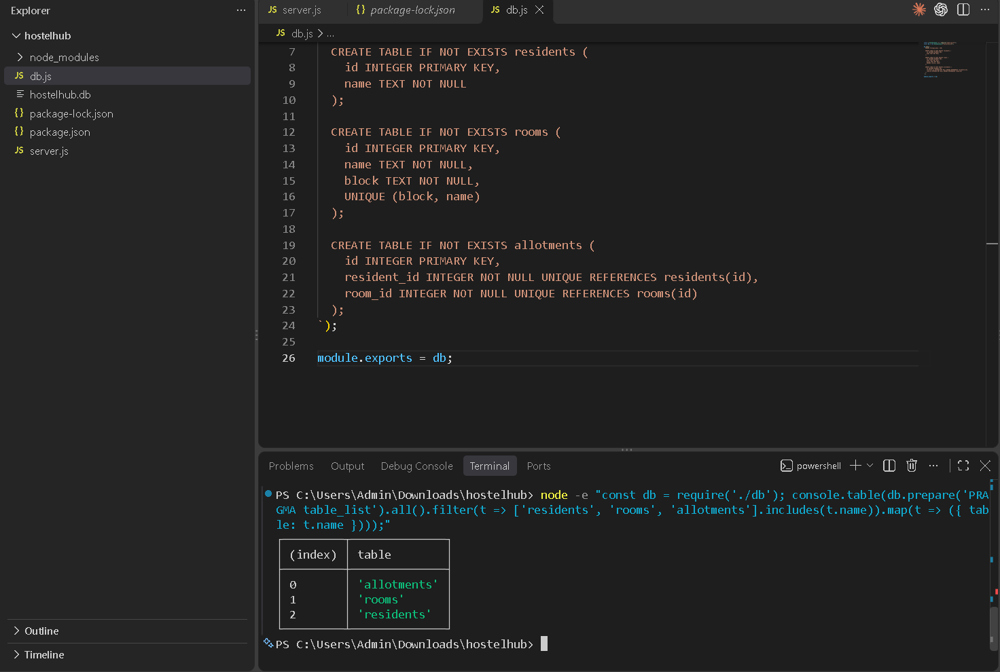

### 2. Sample rooms
The seed script adds rooms 101 and 102 in block A and rooms 201 and 202 in block B.

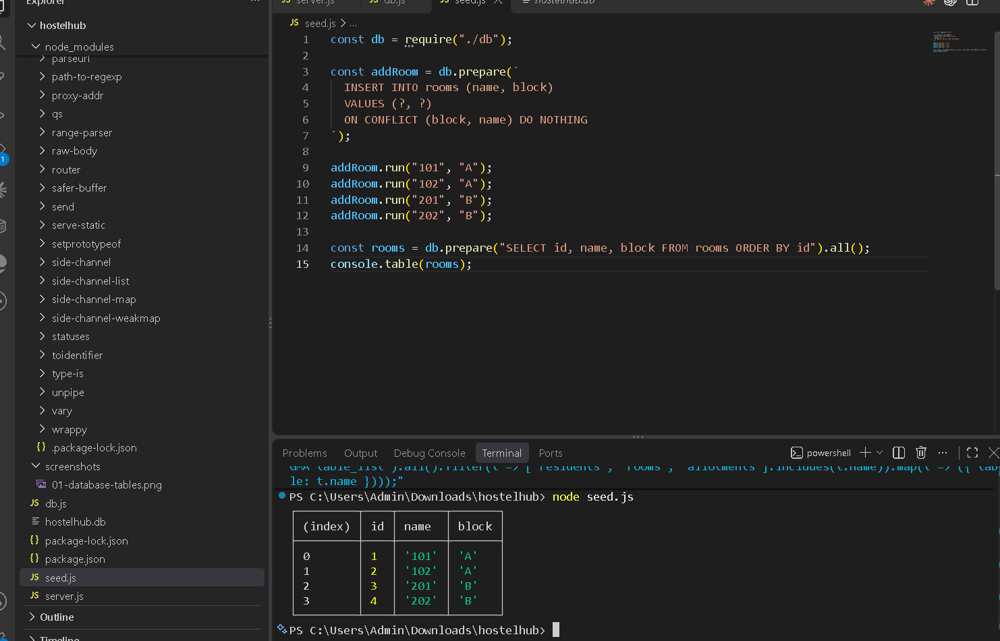

### 3. Pagination — first page
With a limit of two, page 1 returns rooms 101 and 102.

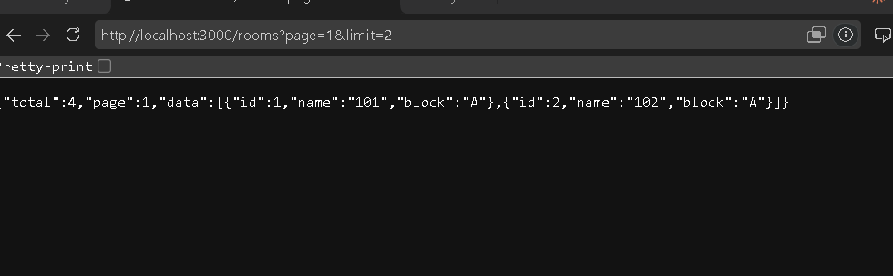

### 4. Pagination — second page
Page 2 returns the next two rooms, 201 and 202.

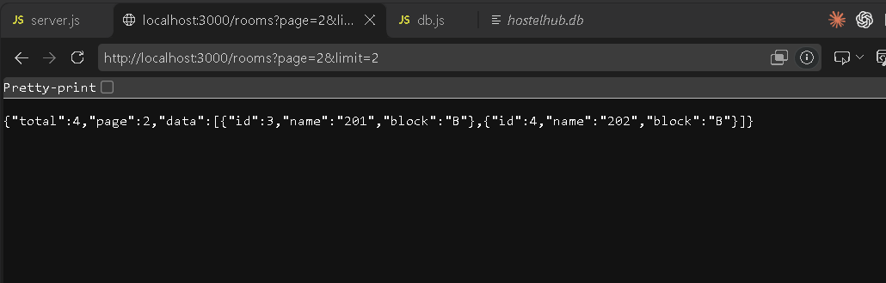

### 5. Invalid page number
Requesting page 0 returns a validation error.

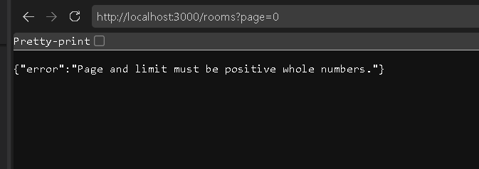

### 6. Search by block
Searching for block A returns rooms 101 and 102.

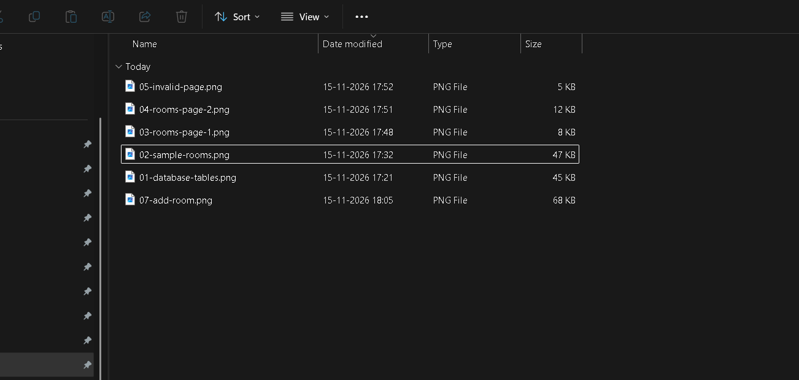

### 7. Add a room
Creating room 301 in block C returns 201 Created and the new room ID.

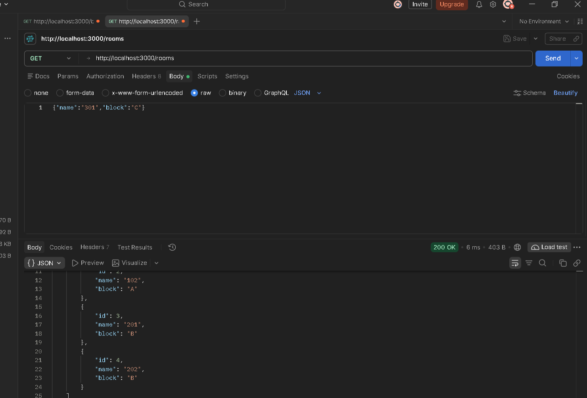

### 8. Validate room details
An update with an empty room name returns 400 Bad Request.

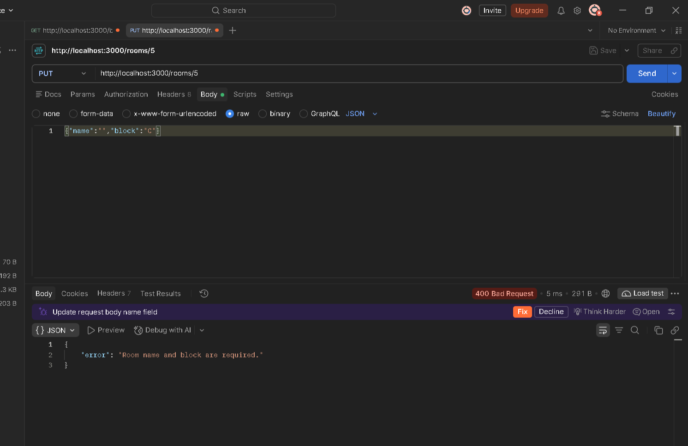

### 9. Update a room
The update changes the room name from 301 to 302.

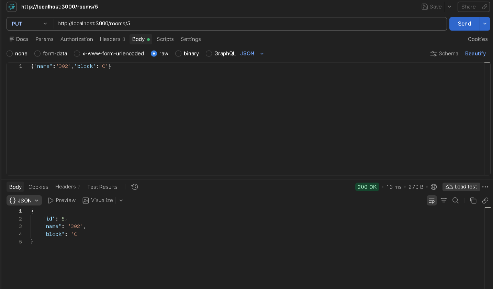

### 10. Delete a room
Deleting the test room returns 204 No Content.

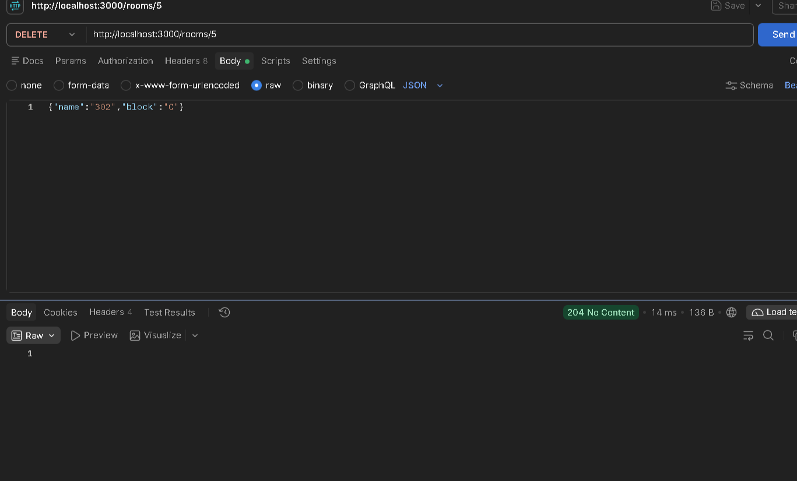

### 11. Show resident and room names
The allotments endpoint joins all three tables to show Asha in room 101, block A.

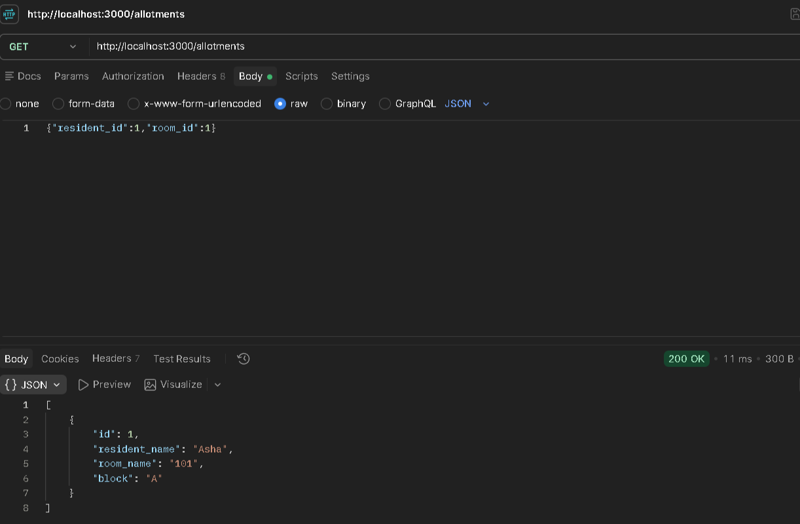

### 12. Find free rooms
After room 101 is allotted, the available-room search for block A returns room 102.

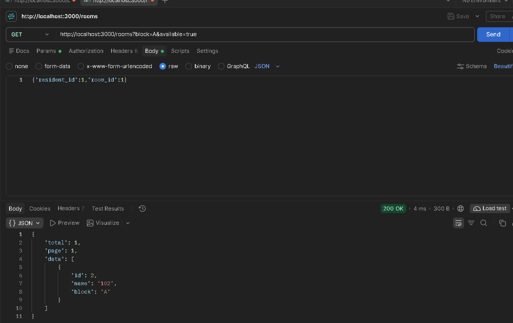
